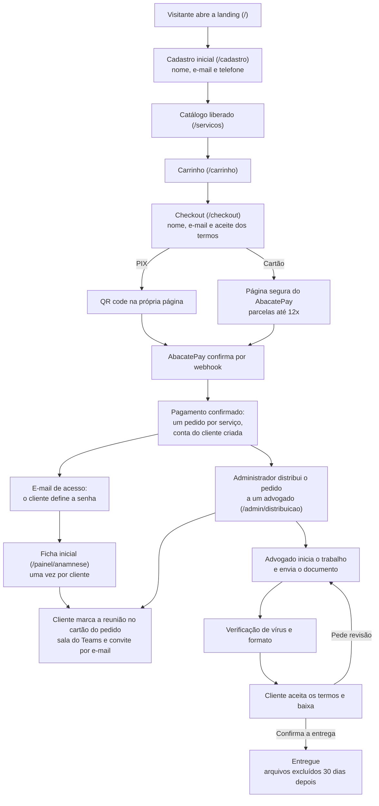
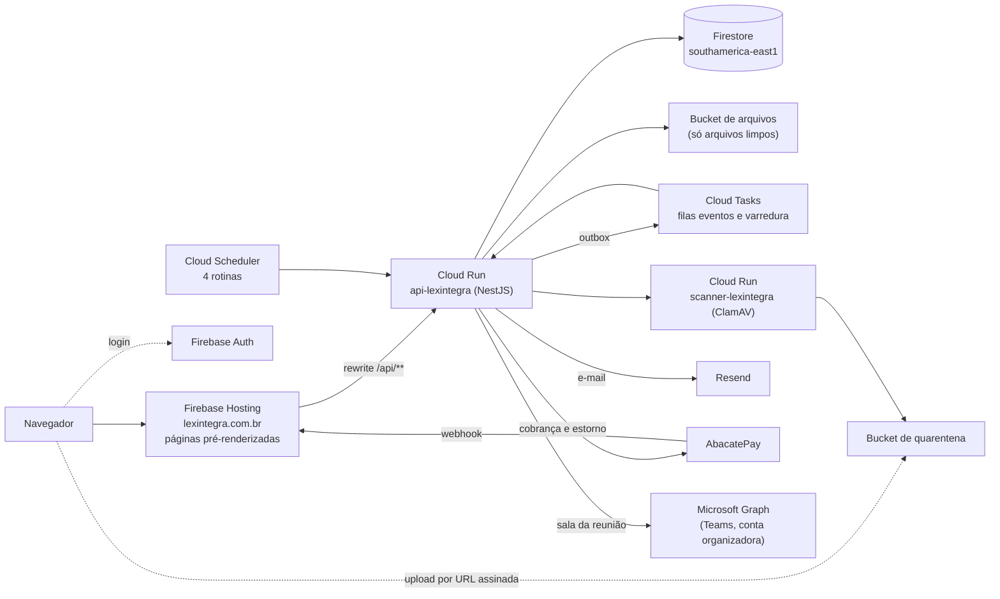

# LexIntegra — documentação

Índice de toda a documentação do projeto. Comece por aqui, seja você do
escritório, seja quem vai manter o sistema.

## O que é

A **LexIntegra** é uma plataforma para vender e acompanhar serviços jurídicos
para empresas, com marca própria, separada do escritório que presta os
serviços (B&C). Ela atende três perfis:

- **cliente:** a empresa que contrata. Conhece o catálogo depois de um cadastro
  inicial, compra por PIX ou cartão, recebe o acesso por e-mail e acompanha
  cada pedido: ficha inicial, arquivos, reuniões, documentos e revisões;
- **advogado:** recebe os pedidos distribuídos a ele, publica os horários de
  atendimento, entrega os documentos e atende as reuniões;
- **administrador:** cuida do catálogo, dos advogados, da distribuição, dos
  pagamentos, estornos e contestações, e dos pedidos de titular (LGPD).

Está em produção em **https://lexintegra.com.br**, com pagamento real
(AbacatePay, PIX e cartão) desde 01/11/2026 e salas do Microsoft Teams desde
02/11/2026.

## O caminho principal

Os manuais por perfil (abaixo) mostram cada passo com capturas de tela.

## A arquitetura em uma página

*Ilustração gerada por IA, sem material de terceiros (origem em
[`revisao-frontend.md`](revisao-frontend.md)).*

| Peça | O que faz | Onde está |
|---|---|---|
| **Firebase Hosting** | Serve o site em `lexintegra.com.br` e encaminha `/api/**` para a API (sem subdomínio, ADR-15) | `firebase.json` |
| **Cloud Run `api-lexintegra`** | Toda a regra de negócio, em NestJS. Rota nova nasce fechada | `apps/api/` |
| **Firestore** | Banco único, em `southamerica-east1`. O navegador não tem acesso direto: as regras negam tudo | `infra/terraform/firestore.tf` |
| **Cloud Storage** | Dois buckets de arquivos: quarentena (antes da varredura) e arquivos (só `limpo`). Nenhum arquivo é servido sem varredura | `infra/terraform/storage.tf` |
| **Cloud Tasks e outbox** | Todo efeito externo (e-mail, sala do Teams, estorno) nasce no outbox, na mesma transação do fato, e é entregue por fila, com reentrega | `apps/api/src/outbox/` |
| **Cloud Scheduler** | Quatro rotinas: varredor do outbox, base do ClamAV, retenção diária (com a política de guarda da LGPD) e sonda de sinais | `infra/terraform/` |
| **Scanner (ClamAV)** | Verifica vírus; a API confere também o formato (magic bytes) | `apps/scanner/` |
| **Resend** | E-mails, de `suporte@notificacoes.lexintegra.com.br`, com resposta para o suporte | `apps/api/src/email/` |
| **AbacatePay** | PIX transparente e cartão pelo checkout hospedado; webhook autenticado por segredo e HMAC | `apps/api/src/pagamentos/` |
| **Microsoft Graph** | Uma sala do Teams por reunião, na conta organizadora do escritório; convidados entram sem conta | `apps/api/src/reunioes/sala/` |
| **Observabilidade** | Log estruturado, trace, 14 alertas por e-mail para `suportelexintegra@gmail.com` e um painel | `infra/terraform/observabilidade.tf` |

O detalhe de cada decisão está em [`arquitetura.md`](arquitetura.md) (ADRs).

## Todos os documentos

### Para o escritório

| Documento | Para quem | O que resolve |
|---|---|---|
| [Manual do cliente](manuais/cliente.md) | Clientes, e quem os atende | Cadastro, compra, senha, ficha, arquivos, reuniões, documentos, cancelamento |
| [Manual do advogado](manuais/advogado.md) | Advogados | Agenda e horários, demandas, envio de documentos, revisões, reunião como convidado |
| [Manual do administrador](manuais/admin.md) | Administradores da plataforma | Produtos, advogados, distribuição, pagamentos, estornos, contestações, entregas, reuniões, administradores, LGPD |
| [Registro dos desvios (minuta)](entrega/desvios-minuta.md) | Escritório e desenvolvedor | O texto para assinar sobre Teams, cartão, carrinho e upload, e a conta organizadora |
| [Termo de cessão (minuta)](entrega/termo-de-cessao-minuta.md) | Escritório e desenvolvedor | A cessão da cláusula 8ª |
| [LGPD](entrega/lgpd.md) | Encarregado e escritório | Papéis, base legal, dados por coleção, subprocessadores, guarda, direitos do titular, incidente |
| [Custos](entrega/operacao.md#9-custos-em-regime-permanente) e [planilha](entrega/custos-regime-permanente.xlsx) | Quem paga a conta | O que é cobrado por mês e por venda |

### Para quem mantém o sistema

| Documento | O que resolve |
|---|---|
| [Documentação de entrega](entrega/README.md) | Ponto de partida de quem assume o sistema |
| [Operação](entrega/operacao.md) | Do push à produção; todas as variáveis; os modos e como desligar cada um; as três integrações; rotinas, buckets e alertas; tarefas do administrador; custos |
| [Credenciais](entrega/credenciais.md) | Inventário de toda credencial e conta, sem valores; como trocar; acessos do desenvolvedor |
| [Transferência](entrega/transferencia.md) | A ordem segura para passar projeto, repositório e contas ao escritório |
| [Guia do código](entrega/guia-do-codigo.md) | Mapa do repositório, como rodar e testar, o que o pipeline cobra |
| [Inventário de custos](entrega/inventario-custos.md) | Tudo o que é cobrado, com quantidades |
| [Licenças de terceiros](entrega/licencas-terceiros.md) | O que o projeto usa e não é dele |
| [Ficha de anamnese](entrega/ficha-anamnese-inicial.md) | A ficha recebida do escritório |
| [Arquitetura](arquitetura.md) | Decisões (ADRs), modelo de dados, custos estimados |
| [Decisões da B2](decisoes.md) | As decisões de produto tomadas com o escritório |
| [Plano de execução](plano-de-execucao.md) | O que cada etapa entregou |
| [Design](design.md) | Direção visual (ADR-22) e o que ela implica |
| [`AGENTS.md`](../AGENTS.md) | Resumo operacional e as regras invioláveis |
| [`CHECKLIST.md`](../CHECKLIST.md) | A única lista do que ainda está aberto |

### Runbooks (quando algo dá errado)

Todos seguem o mesmo roteiro: sintoma, como confirmar, o que fazer, o que
nunca fazer e como saber que resolveu. Cada alerta traz o caminho do seu
runbook.

| Runbook | Quando abrir |
|---|---|
| [alerta-critico](runbooks/alerta-critico.md) | Chegou *Alerta critico da aplicacao*; triagem pelo assunto |
| [pagamento-orfao](runbooks/pagamento-orfao.md) | Houve pagamento e não há pedido |
| [webhook-fora-do-ar](runbooks/webhook-fora-do-ar.md) | O AbacatePay não entrega eventos, ou o evento é desconhecido |
| [webhook-recusado](runbooks/webhook-recusado.md) | Recusas do webhook em série |
| [outbox-parado](runbooks/outbox-parado.md) | E-mail, sala ou estorno não saiu; reenvio manual |
| [entrega-de-email-falhando](runbooks/entrega-de-email-falhando.md) | O Resend recusa, inclusive pelo teto diário |
| [reuniao-sem-link](runbooks/reuniao-sem-link.md) | Reunião marcada sem sala do Teams |
| [secret-expirado](runbooks/secret-expirado.md) | Credencial vencida ou revogada; **o segredo do Graph vence em 01/11/2027** |
| [scanner-indisponivel](runbooks/scanner-indisponivel.md) | Arquivo parado em quarentena, base do ClamAV velha |
| [api-fora-do-ar](runbooks/api-fora-do-ar.md) | O uptime check falhou |
| [retencao-parada](runbooks/retencao-parada.md) | A retenção diária não concluiu |
| [sonda-parada](runbooks/sonda-parada.md) | A sonda de sinais parou |
| [deploy-recusado](runbooks/deploy-recusado.md) | Pipeline vermelho, revisão que não sobe |
| [lgpd-titular](runbooks/lgpd-titular.md) | Pedido de exportação ou eliminação de titular |
| [alerta-artificial](runbooks/alerta-artificial.md) | Provar que um alerta chega |
| [ligar-terceiros](runbooks/ligar-terceiros.md) | Como o AbacatePay e o Teams foram ligados, e como religar do zero |
| [checkout-sandbox](runbooks/checkout-sandbox.md) | Testar mudança no pagamento contra o sandbox |
| [emails-html](runbooks/emails-html.md) | Layout dos e-mails e como pré-visualizar |
| [limpeza-infra](runbooks/limpeza-infra.md) | Conferências e remoções manuais de infraestrutura |

### Registros históricos

Documentos de uma fase do projeto, mantidos como registro:
[`historico-etapas.md`](historico-etapas.md) (as notas por etapa que ficavam no `AGENTS.md`, com as armadilhas de cada módulo),
[`achados-2026-09-29-alertas-e-clamav.md`](achados-2026-09-29-alertas-e-clamav.md),
[`design-audit.md`](design-audit.md),
[`etapa6-relatorio-acessibilidade-performance.md`](etapa6-relatorio-acessibilidade-performance.md),
[`identidade-navegacao.md`](identidade-navegacao.md),
[`imagens-landing.md`](imagens-landing.md),
[`relatorio-qualidade.md`](relatorio-qualidade.md),
[`revisao-frontend.md`](revisao-frontend.md) e os protótipos em `prototipos/`.
