# Manual do administrador

Como administrar a LexIntegra pelo painel em
**https://lexintegra.com.br/admin**. Para quem opera o dia a dia do escritório
na plataforma. O que exige acesso técnico (Google Cloud, Secret Manager,
painéis de terceiros) está em [`operacao.md`](../entrega/operacao.md) e nos
[runbooks](../README.md#runbooks-quando-algo-dá-errado).

> As imagens foram feitas num ambiente de teste, com empresas e pessoas
> fictícias.

O menu tem duas partes: o trabalho de rotina (**Distribuição, Clientes,
Advogados, Produtos, Estornos, Administradores**) e, sob **Quando algo
falha**, as telas de exceção (**Contestações, Pagamentos, Entregas,
Reuniões**). Toda ação sobre contas e pagamentos fica registrada no log de
auditoria.

---

## 1. Produtos (catálogo)

Em **Produtos** (`/admin/produtos`) ficam os serviços do catálogo. O catálogo
de produção nasce vazio: é o escritório quem cria os produtos.

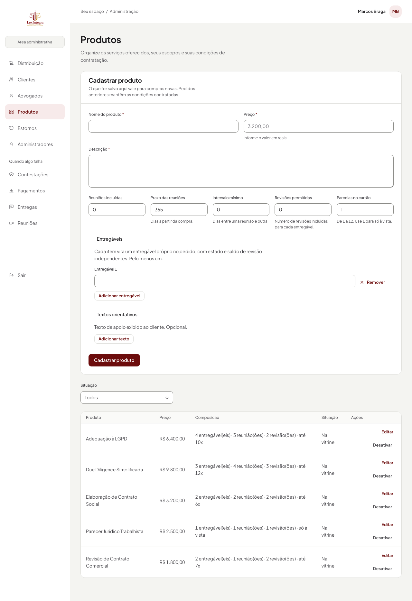

Para criar, preencha o formulário do topo; para alterar, clique em **Editar**
na linha do produto.

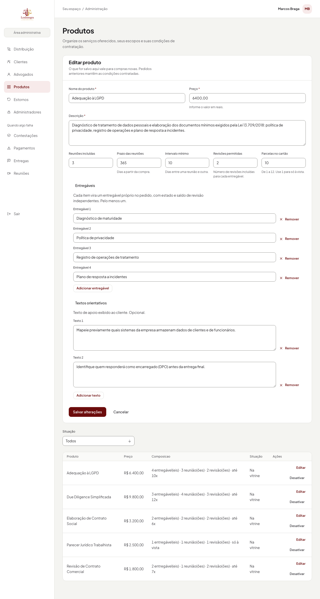

| Campo | O que é |
|---|---|
| Nome e descrição | O que o cliente vê no catálogo |
| **Preço** | Em reais. O cliente paga esse valor, no PIX ou no cartão |
| Reuniões incluídas | Quantas reuniões o pedido dá direito a marcar |
| Prazo das reuniões | Em dias a partir da compra; depois disso, o saldo de reuniões vence |
| Intervalo mínimo | Dias entre uma reunião e outra do mesmo pedido |
| Revisões permitidas | Quantas revisões o cliente pode pedir **por documento** |
| **Parcelas no cartão** | De 1 a 12. Use 1 para "só à vista". O catálogo anuncia a parcela ("6x de R$ 533,33"). **A página do AbacatePay oferece até 12x em todo produto** (é configuração do painel do AbacatePay); este campo só governa o que o site anuncia |
| **Entregáveis** | Cada item vira um documento próprio no pedido, com estado e revisões. Pelo menos um, até 60 |
| Textos orientativos | Dicas que o cliente lê no cartão do pedido. Opcionais |

**O que for salvo vale só para compras novas.** Pedidos já comprados mantêm as
condições da compra (preço, reuniões, revisões, entregáveis).

Não há exclusão de produto: use **Desativar** para tirar da vitrine, e
**Reativar** para voltar.

## 2. Advogados

Em **Advogados** (`/admin/advogados`):

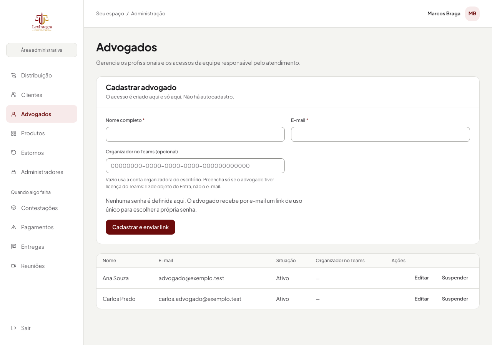

- **Cadastrar:** nome completo e e-mail, depois **Cadastrar e enviar link**.
  O advogado recebe por e-mail o link para definir a senha. Não existe outra
  forma de criar acesso de advogado.
- **Editar:** nome e e-mail. Trocar o e-mail muda o login e manda um link novo
  para o endereço novo.
- **Reuniões no Teams:** não há nada a preencher. As salas são criadas pela
  conta organizadora do escritório, e o advogado entra como convidado. A coluna
  **Organizador no Teams** da lista só mostra valor para o advogado que tiver
  licença própria, configurada pelo desenvolvedor
  ([`ligar-terceiros.md`](../runbooks/ligar-terceiros.md), 2.6).
- **Suspender:** corta o acesso **na hora**, inclusive de quem está com a
  sessão aberta. Recusado se o advogado tiver reunião futura marcada: cancele
  ou redistribua antes. **Reativar** devolve o acesso.

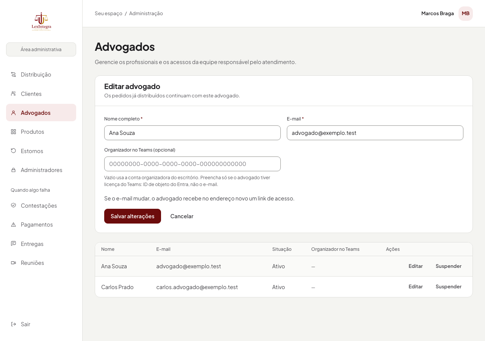

## 3. Distribuição

Em **Distribuição** (`/admin/distribuicao`), o filtro **A distribuir** mostra
os pedidos pagos que ainda não têm advogado. Escolha o advogado na linha e
clique em **Distribuir**. O pedido aparece nas demandas dele, e o cliente passa
a poder marcar reuniões.

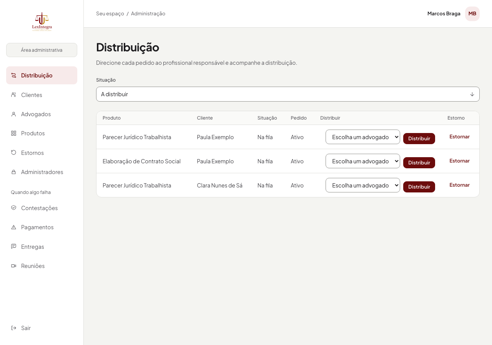

Trocar o advogado de um pedido com reunião futura marcada é recusado: cancele
a reunião antes.

## 4. Clientes

Em **Clientes** (`/admin/clientes`), busque por nome ou e-mail e filtre por
produto contratado. A lista mostra nome, e-mail e produtos contratados. A
**ficha inicial** do cliente aparece para o advogado do pedido, em
**Demandas**; para o administrador, ela não tem tela (só a rota
`GET /api/admin/clientes/{uid}/anamnese`, [`operacao.md`](../entrega/operacao.md), seção 8).

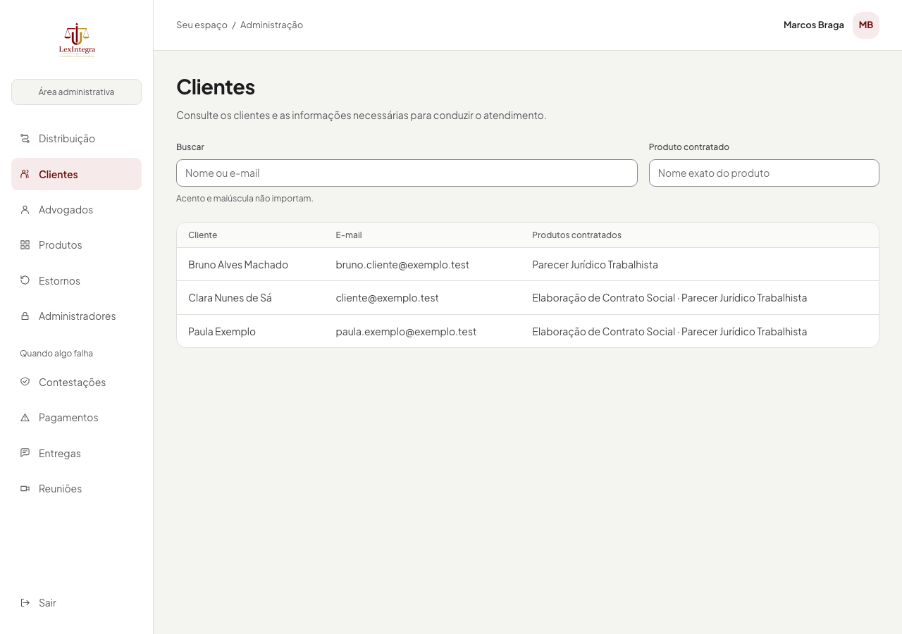

## 5. Estornos

O estorno se pede na **Distribuição**, pelo botão **Estornar** da linha do
pedido. Informe o **motivo** e clique em **Confirmar estorno**.

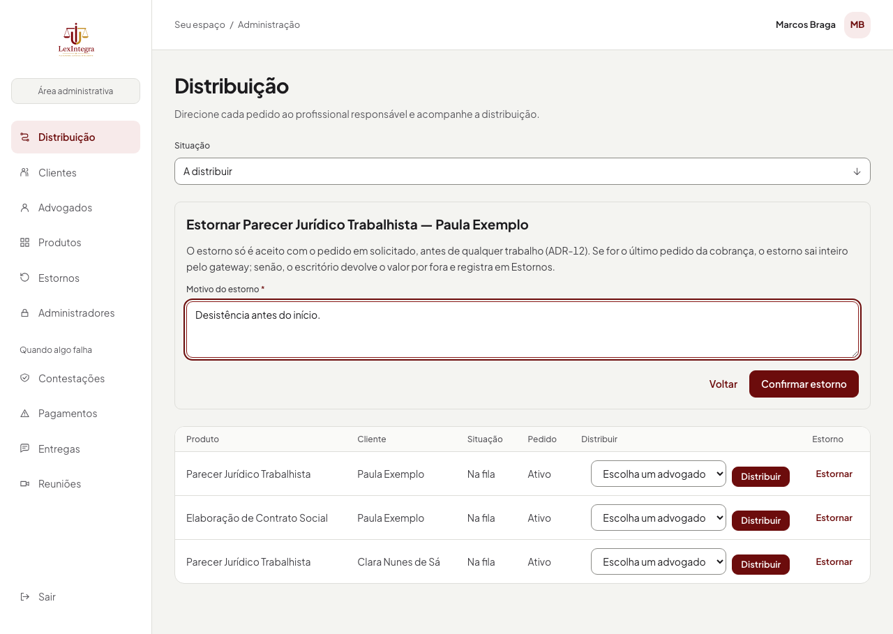

O estorno só é aceito com o pedido **antes de qualquer trabalho**: documentos
em *Solicitado*, nenhuma reunião já realizada e nenhuma contestação aberta. Se
uma condição falhar, a tela diz qual. Reuniões futuras do pedido são canceladas
junto.

O que acontece com o dinheiro depende da compra:

- **Era o último pedido ativo da cobrança:** o estorno **integral** sai
  sozinho pelo AbacatePay (PIX ou cartão). Acompanhe em **Entregas**.
- **A cobrança tinha outros pedidos ativos** (carrinho com vários serviços): o
  AbacatePay só estorna cobrança inteira, então **a devolução deste pedido é
  feita pelo escritório, por fora** (PIX ou transferência). O pedido aparece em
  **Estornos** (`/admin/estornos`); depois de devolver, registre ali.

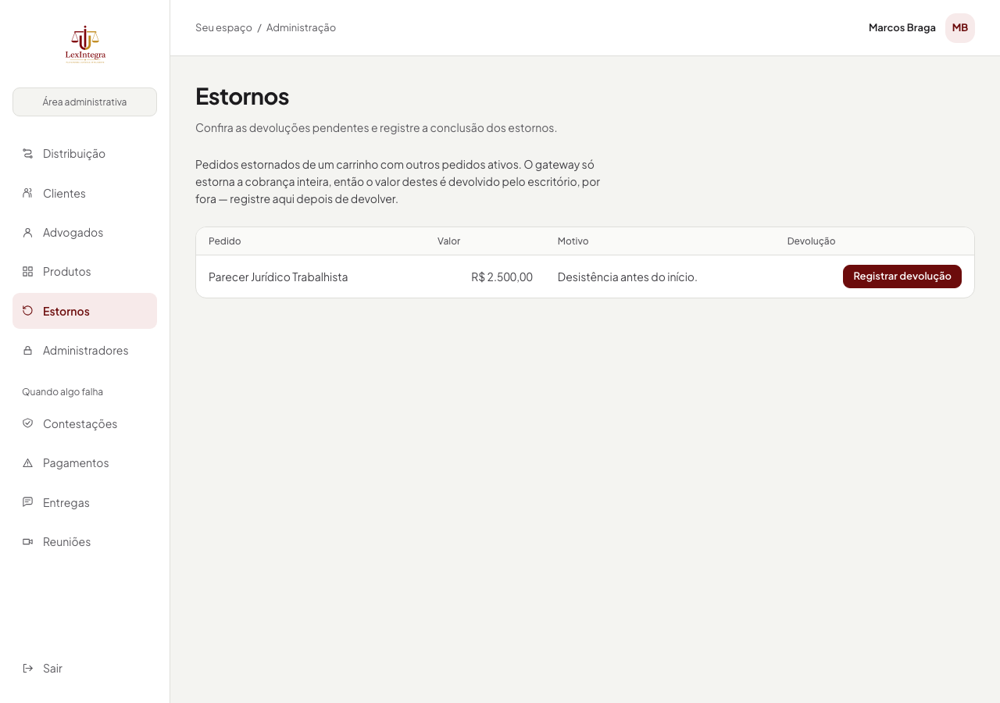

Prazo combinado: iniciar a devolução em até **5 dias úteis** depois de
aprovado o estorno.

O **cancelamento pelo cliente** não devolve dinheiro: se ele pedir a
devolução, é você quem decide e estorna.

## 6. Pagamentos com problema

Em **Pagamentos** (`/admin/pagamentos`) aparecem os pagamentos que **não
viraram pedido**. O cliente pagou e não recebeu nada; cada caso também gera um
alerta por e-mail para o suporte.

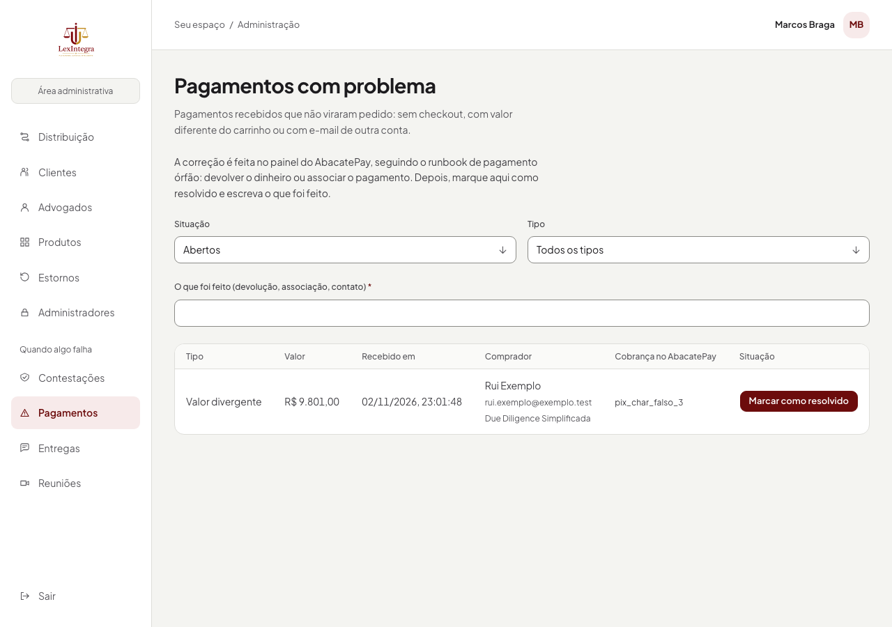

| Tipo | O que houve |
|---|---|
| **Órfão** | O pagamento chegou e a intenção de compra não existe mais (por exemplo, o PIX foi pago muito depois de vencer) |
| **Valor divergente** | O valor cobrado é diferente do total do carrinho |
| **Conflito de conta** | O e-mail do comprador já é de um advogado ou administrador |

A correção é feita **no painel do AbacatePay** (devolver o dinheiro, ou
combinar com o comprador uma nova compra). Depois, escreva o que foi feito e
clique em **Marcar como resolvido**. A tela não move dinheiro. Prazos: associar
um órfão em até **2 dias úteis**; sem identificação em **30 dias**, devolver à
origem. Passo a passo: [`pagamento-orfao.md`](../runbooks/pagamento-orfao.md).

## 7. Contestações

Quando o cliente contesta a cobrança no banco ou no cartão (chargeback), a
plataforma **pausa** todos os pedidos daquela cobrança: nada neles muda, as
reuniões futuras são canceladas com devolução ao saldo, e o cliente recebe um
e-mail.

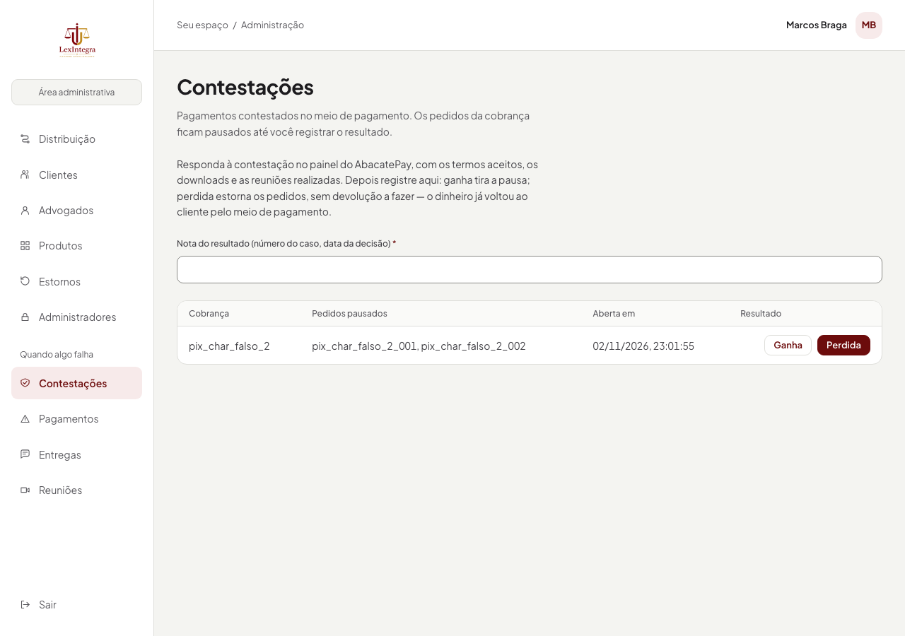

1. Responda à contestação **no painel do AbacatePay**, com as provas que a
   plataforma guarda: termos aceitos, downloads, reuniões realizadas.
2. Quando sair a decisão, escreva a nota (número do caso, data) e registre:
   - **Ganha:** a pausa sai e os pedidos seguem;
   - **Perdida:** os pedidos são estornados, sem devolução a fazer (o dinheiro
     já voltou ao cliente pelo meio de pagamento).

## 8. Entregas (e-mails, salas e estornos)

Em **Entregas** (`/admin/entregas`) está tudo o que a plataforma manda para
fora: e-mails, convites de reunião, salas do Teams e estornos no AbacatePay.
Filtre pela situação.

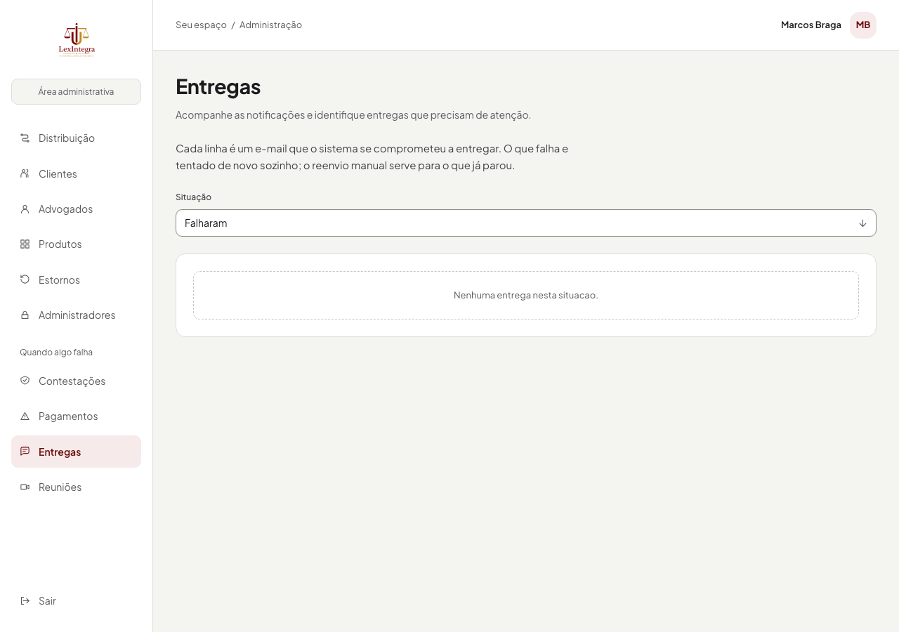

Um item **com falha** ou **abandonado** (desistiu depois de várias tentativas)
tem o botão **Reenviar agora**, que tenta de novo pelo mesmo caminho, sem
duplicar. Antes, leia o motivo do erro: se for o provedor fora do ar ou uma
credencial vencida, o reenvio só funciona depois da correção
([`outbox-parado.md`](../runbooks/outbox-parado.md)).

## 9. Reuniões sem sala

Em **Reuniões** (`/admin/reunioes`) aparecem as reuniões marcadas cuja sala do
Teams **não foi criada**: o cliente vê "Link a caminho…" e não recebeu o
convite. Uma lista vazia é o normal.

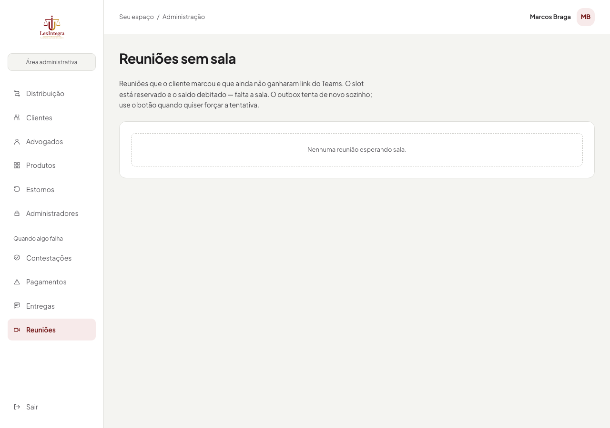

- **Tentar de novo:** depois de corrigida a causa (por exemplo, o segredo do
  aplicativo da Microsoft vencido, que **vence em 01/11/2027**), a sala é
  criada e o convite sai. Não cria sala duplicada. Causas e correções:
  [`reuniao-sem-link.md`](../runbooks/reuniao-sem-link.md).
- **Cancelar reunião:** desmarca pelo escritório. A reunião sempre volta ao
  saldo do cliente, que recebe e-mail para marcar outro horário.

**Nunca** mande ao cliente um link de reunião feito à mão ou de outra reunião.

## 10. Administradores

Em **Administradores** (`/admin/administradores`):

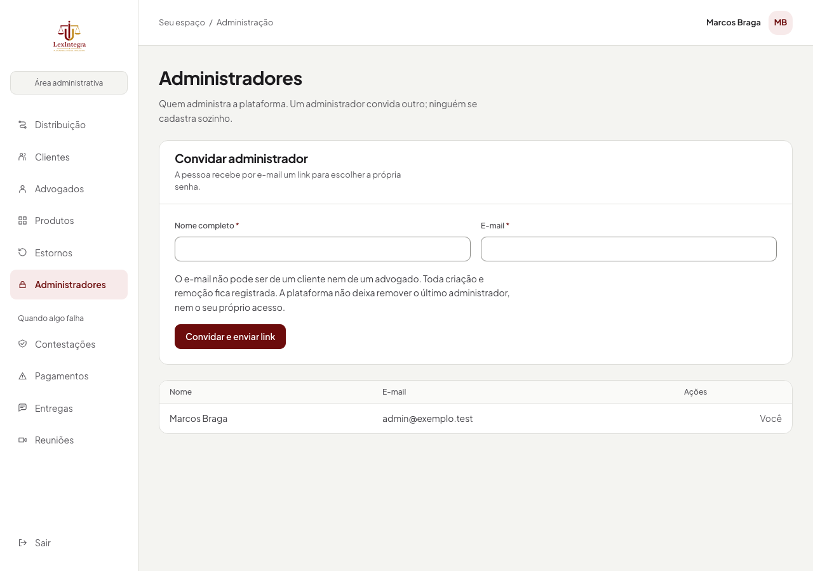

- **Convidar:** nome completo e e-mail, depois **Convidar e enviar link**. A
  pessoa recebe o link para definir a senha. E-mail que já é de cliente ou de
  advogado é recusado: use outro endereço.
- **Remover acesso:** tira o acesso na hora. A plataforma não deixa você
  remover a si mesmo nem o **último** administrador.

**Na entrega do projeto:** o desenvolvedor convida o Auan; depois que o Auan
entrar, **o Auan remove o acesso do desenvolvedor** nesta tela
([`transferencia.md`](../entrega/transferencia.md), 6.4a).

## 11. LGPD: pedidos de titular

**Não há tela para LGPD.** Os pedidos chegam ao encarregado pelo
`suportelexintegra@gmail.com` e são atendidos em até **15 dias corridos**:

- **cópia dos dados:** um pacote com os dados e os arquivos do titular;
- **eliminação:** a plataforma registra o pedido, avisa o titular por e-mail e
  elimina **7 dias** depois. O que a lei manda guardar (pedidos, pagamentos e
  aceites, por 5 anos depois do último pedido) fica, e a resposta ao titular
  diz até quando;
- **retenção legal:** processo, obrigação legal ou pedido de autoridade
  suspende a eliminação; é registrada pelo administrador.

As três são feitas por chamadas à API com a sessão de administrador, por quem
opera a plataforma, seguindo o roteiro
[`lgpd-titular.md`](../runbooks/lgpd-titular.md). O que o escritório decide e
guarda está em [`lgpd.md`](../entrega/lgpd.md).
