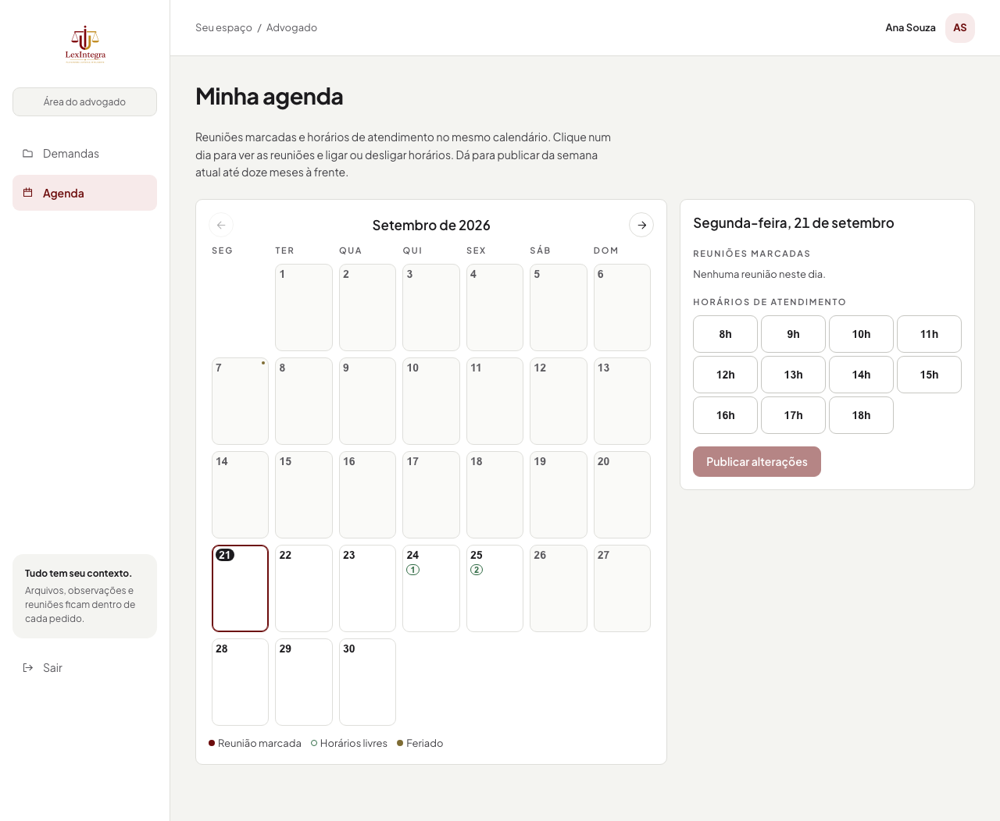
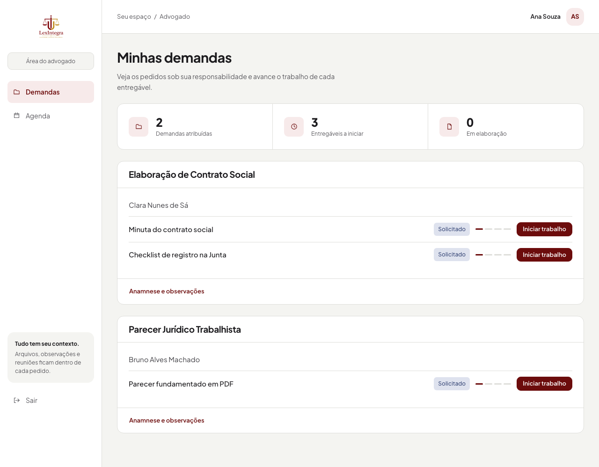
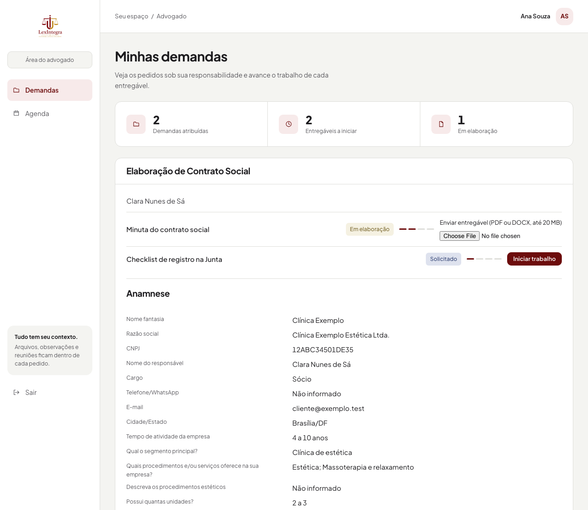
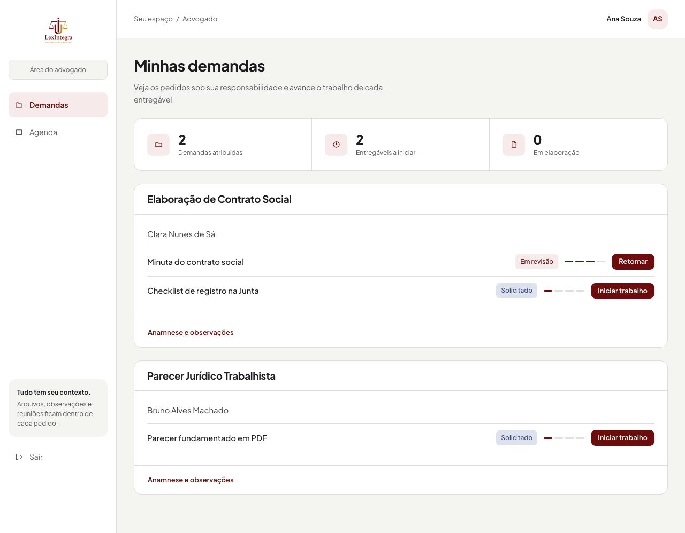

# Manual do advogado

Como trabalhar os pedidos na LexIntegra, em **https://lexintegra.com.br**.

> As imagens foram feitas num ambiente de teste, com empresas e pessoas
> fictícias.

---

## 1. O primeiro acesso

O acesso de advogado é criado pela administração do escritório (não há
cadastro próprio). Você recebe um e-mail da LexIntegra com o link para
**definir a sua senha** (pelo menos 12 caracteres). Depois, entre em **Entrar**
(`/entrar`) com o e-mail e a senha. Para trocar ou recuperar a senha: **Criar
ou recuperar senha**, na mesma tela.

A sua área tem dois itens no menu: **Demandas** e **Agenda**. Você vê
**apenas os pedidos distribuídos a você**.

## 2. Agenda: horários de atendimento e reuniões marcadas

Em **Agenda** (`/advogado/agenda`) ficam, no mesmo calendário do mês, as
reuniões que os clientes marcaram e os seus horários de atendimento.

- **Dias:** um ponto vermelho é reunião marcada; o número em verde é a
  quantidade de horários livres; feriados nacionais e pontos facultativos
  federais aparecem marcados (só marcados: você decide se atende).
- **Clique num dia** para ver, à direita, as **reuniões marcadas** (com o nome
  do cliente e o link da sala) e os **horários de atendimento** daquele dia.
- **Ligar e desligar horários:** clique nas horas para ligar ou desligar e, no
  fim, clique em **Publicar alterações**. Dá para publicar da semana atual até
  **12 meses à frente**. Os clientes só veem horários publicados, e só podem
  marcar com **24 horas** de antecedência.
- Um horário que já tem reunião marcada não pode ser desligado. Se precisar
  desmarcar, peça à administração: ela cancela pelo escritório, e o cliente
  recebe a reunião de volta e um convite para remarcar.

## 3. Demandas

Em **Demandas** (`/advogado/demandas`) cada pedido distribuído a você é um
cartão, com o cliente, os documentos a entregar (os "entregáveis") e o estado
de cada um. No topo, quantos pedidos você tem, quantos documentos esperam
início e quantos estão em elaboração.

### Iniciar o trabalho

Clique em **Iniciar trabalho** no documento. Ele passa de *Solicitado* para
*Em elaboração*. **A partir daqui, o cliente não pode mais cancelar o pedido
nem pedir estorno pela plataforma**: só inicie quando for trabalhar de fato.

### Ficha inicial e observações

Clique em **Anamnese e observações** para ver a **ficha inicial** da empresa
(as respostas do cliente) e as observações do pedido. Para responder ao
cliente, escreva em **Responder ao cliente** e clique em **Enviar resposta**.
A ficha tem informações confidenciais da empresa: não a copie para fora da
plataforma além do necessário.

### Enviar o documento

Em **Enviar entregável (PDF ou DOCX, até 20 MB)**, escolha o arquivo. Regras:

- **PDF ou DOCX**, até **20 MB**, um arquivo por vez;
- `.doc` antigo e `.docm` (com macro) são recusados;
- todo arquivo passa por **verificação de vírus e de formato** antes de chegar
  ao cliente. Se for reprovado, ele nunca fica disponível; envie outro.

Cada envio é uma **versão** nova do documento. O cliente recebe a versão
depois da verificação, aceita o termo de uso e baixa.

### Revisões

O cliente pode **pedir revisão** enquanto tiver saldo (o número de revisões
incluídas é do serviço contratado). O documento volta para você como
*Em revisão*: clique em **Retomar**, ajuste e envie a nova versão.

Quando o cliente **confirma a entrega**, o documento fica *Entregue*. Só o
cliente confirma. Os arquivos do pedido são excluídos da plataforma **30 dias**
depois de todos os documentos serem entregues: **guarde a cópia do escritório
fora da plataforma**.

### Pedido pausado

Se o cliente contestar o pagamento no cartão ou no banco, o pedido aparece
**pausado**, com um aviso, e nada nele muda até a administração registrar o
resultado.

## 4. Entrar na reunião

Quando um cliente marca, remarca ou cancela uma reunião, você recebe um e-mail
com o **convite de calendário** (`.ics`). Abra-o para adicionar à sua agenda;
o link da sala está na descrição do evento, e também na sua **Agenda**.

As salas do Teams são criadas por uma **conta do escritório**, e não pela sua.
Por isso, na hora da reunião:

1. abra o link **no navegador** (não no aplicativo do Teams com a sua conta);
2. digite o seu nome;
3. entre **como convidado**.

Não precisa de conta do Teams. Você pode falar, usar câmera e **compartilhar a
tela**. Não há sala de espera (o cliente entra direto, e você também), não há
chat e a reunião **não é gravada**. Ninguém é "organizador" dentro da reunião.
