# Manual do cliente

Como contratar e acompanhar um serviço na LexIntegra, em
**https://lexintegra.com.br**. Serve para o cliente e para quem, no escritório,
o ajuda pelo telefone ou e-mail.

> As imagens foram feitas num ambiente de teste, com empresas e pessoas
> fictícias. Os serviços, preços e datas que aparecem nelas são exemplos.

**Dúvidas:** `suportelexintegra@gmail.com`. É também para lá que chegam as
respostas a qualquer e-mail da plataforma.

---

## 1. Conhecer os serviços: o cadastro inicial

A página inicial apresenta a LexIntegra. Para ver os serviços e os preços,
clique em **Ver serviços e preços** ou **Cadastro**.

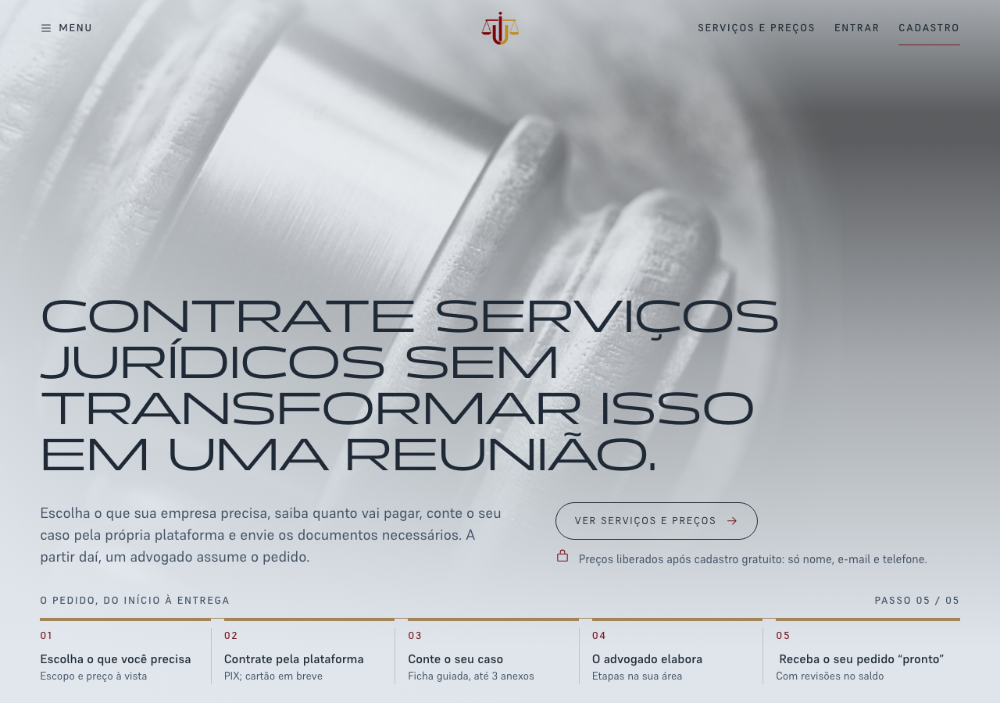

O cadastro inicial pede **nome completo, e-mail e telefone**. Não é a conta
ainda: ele só libera o catálogo por **7 dias** neste navegador. Depois disso,
basta repetir o cadastro com o mesmo e-mail.

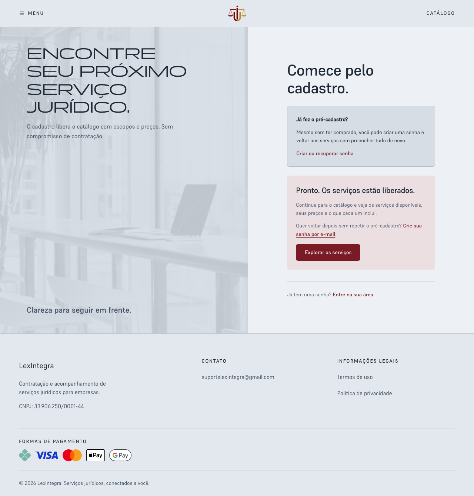

## 2. Escolher os serviços e o carrinho

Em **Serviços** (`/servicos`) aparece cada serviço com o preço, o que está
incluído e, quando o serviço pode ser parcelado no cartão, a parcela em
destaque (por exemplo, "6x de R$ 533,33"). Use a busca no topo para filtrar.

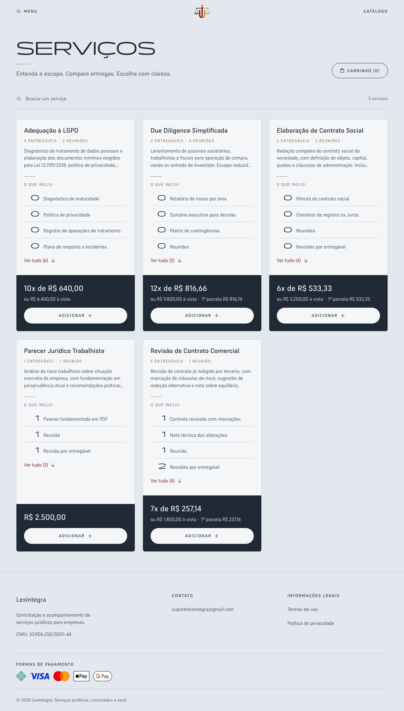

Clique em **Adicionar ao carrinho** em cada serviço que quiser. No carrinho
(`/carrinho`) você revê os itens, remove o que não quer e segue para o
pagamento. **Cada serviço vira um pedido separado**, com prazos, reuniões e
documentos próprios.

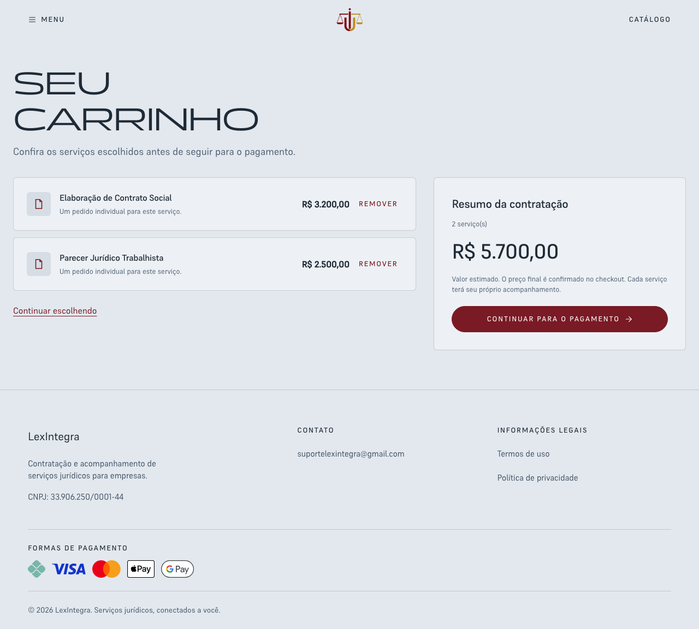

## 3. Pagar

No checkout (`/checkout`), informe **nome completo e e-mail**. Atenção: **é
para esse e-mail que vai o link de acesso à sua área**. Leia os termos de
contratação, marque **Li e aceito os termos de contratação** e escolha a forma
de pagamento.

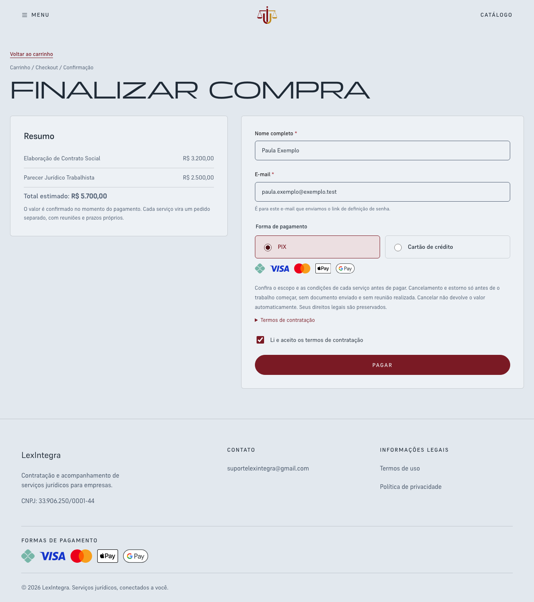

### Com PIX

Escolha **PIX** e clique em **Pagar**. Aparecem o QR code e o código copia e
cola, com o horário até quando valem. Pague pelo aplicativo do seu banco e
**mantenha a página aberta**: ela confirma sozinha, em alguns segundos.

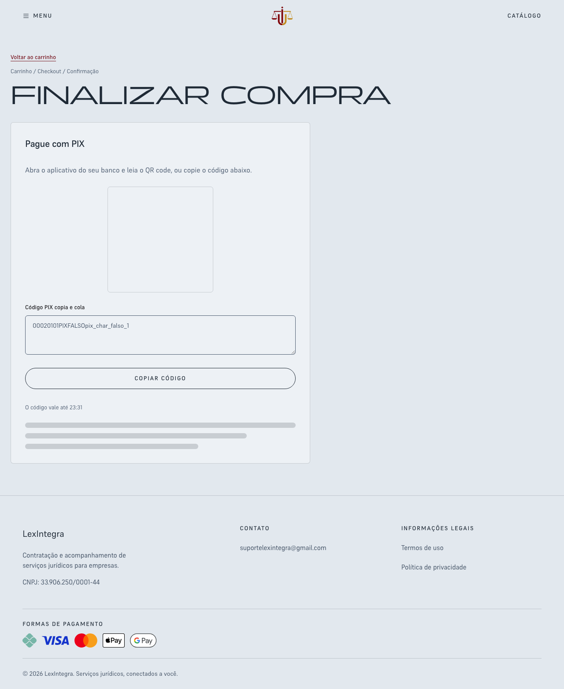

*(No ambiente de teste da imagem, o QR fica em branco; no site real, aparece o
QR code do banco.)*

### Com cartão

Escolha **Cartão de crédito** e clique em **Pagar**. Você vai para a **página
segura do AbacatePay**, o meio de pagamento da LexIntegra. Lá você digita os
dados do cartão e **escolhe em quantas vezes pagar** (até 12x, conforme o
serviço). Ao terminar, volta para a LexIntegra, que mostra a confirmação. Os
dados do cartão **nunca passam pela LexIntegra**.

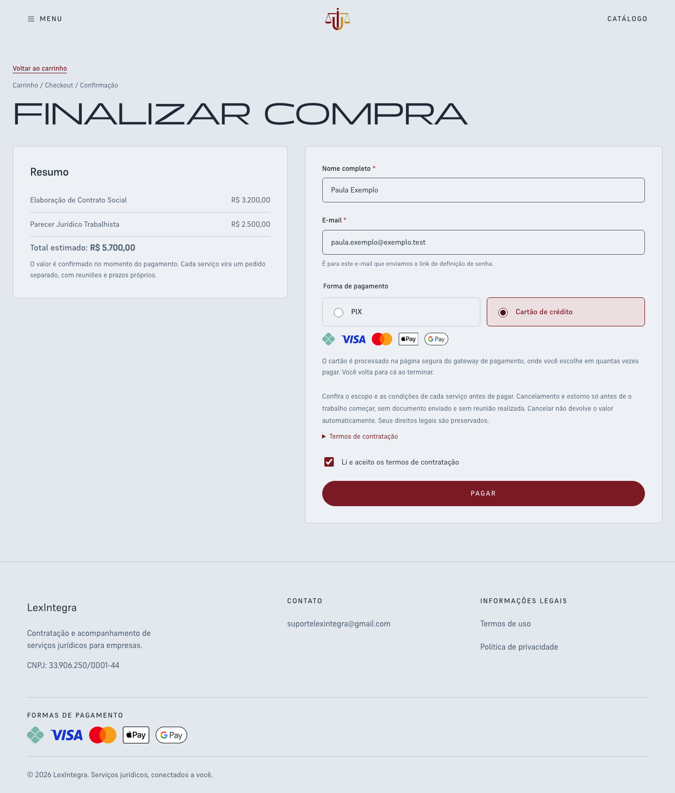

Formas aceitas: PIX, Visa, Mastercard, Apple Pay e Google Pay.

### Pagamento confirmado

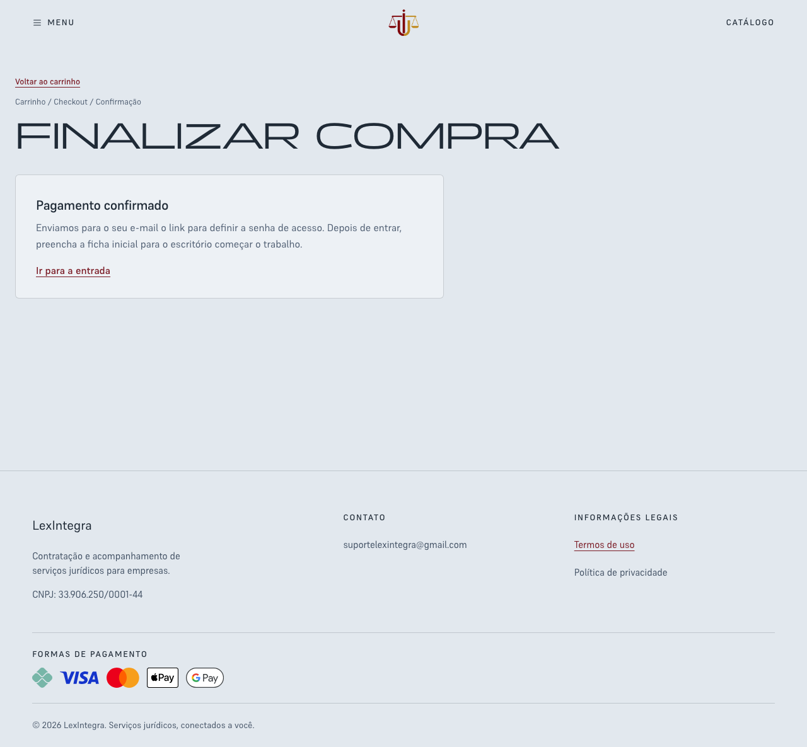

Se a página disser que o pagamento **não está mais disponível**, o prazo do
PIX venceu: clique em **Gerar novo pagamento**.

## 4. O e-mail de acesso e a senha

Logo depois do pagamento chega um e-mail da LexIntegra (remetente
`suporte@notificacoes.lexintegra.com.br`) com o link para **definir a sua
senha**. Confira também a caixa de spam. Na primeira compra a conta é criada
com o e-mail informado no checkout; nas compras seguintes, use o mesmo e-mail
e a mesma senha.

A senha precisa ter **pelo menos 12 caracteres**.

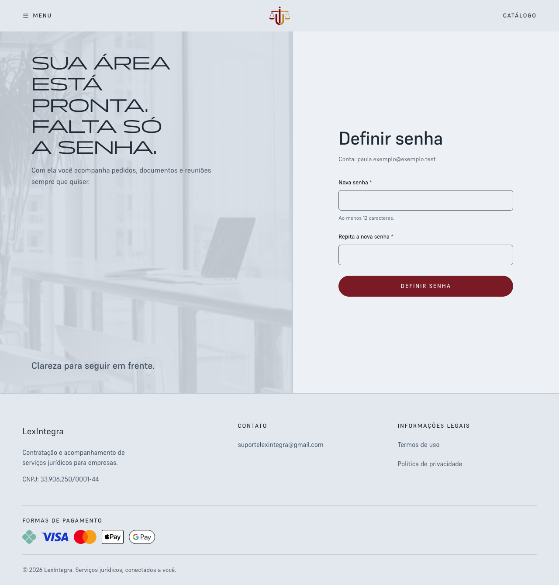

Depois, entre em **Entrar** (`/entrar`) com e-mail e senha.

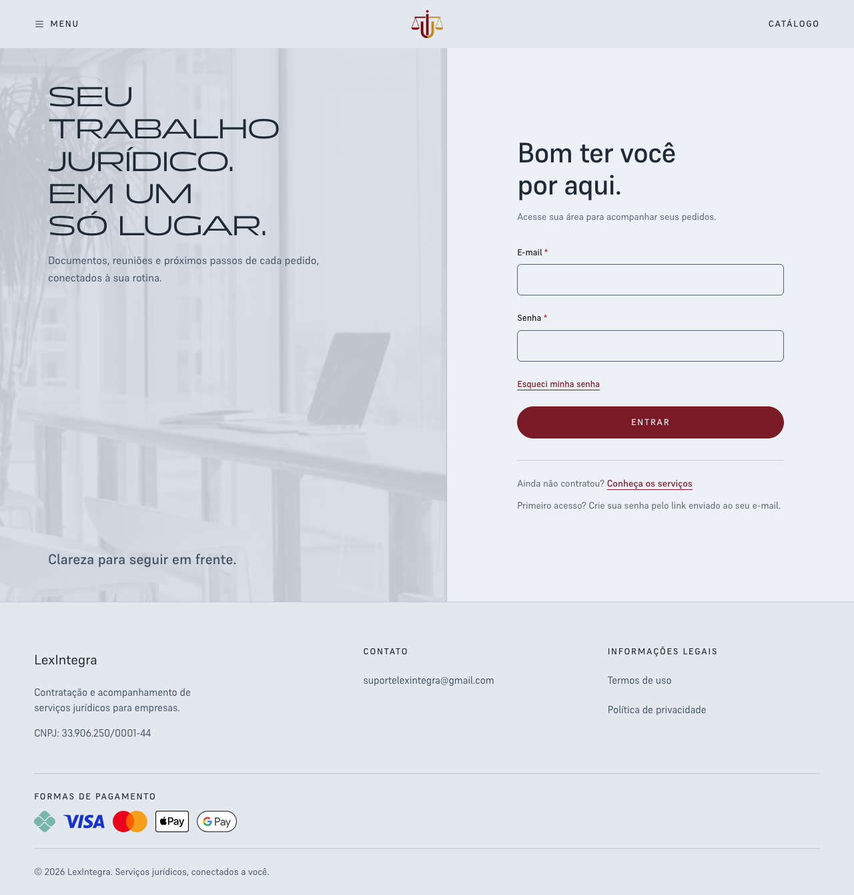

### Esqueci a senha

Em **Entrar**, clique em **Criar ou recuperar senha** (`/recuperar-senha`), informe
o e-mail e siga o link que chegar. O link vale por pouco tempo: se vencer, peça
outro.

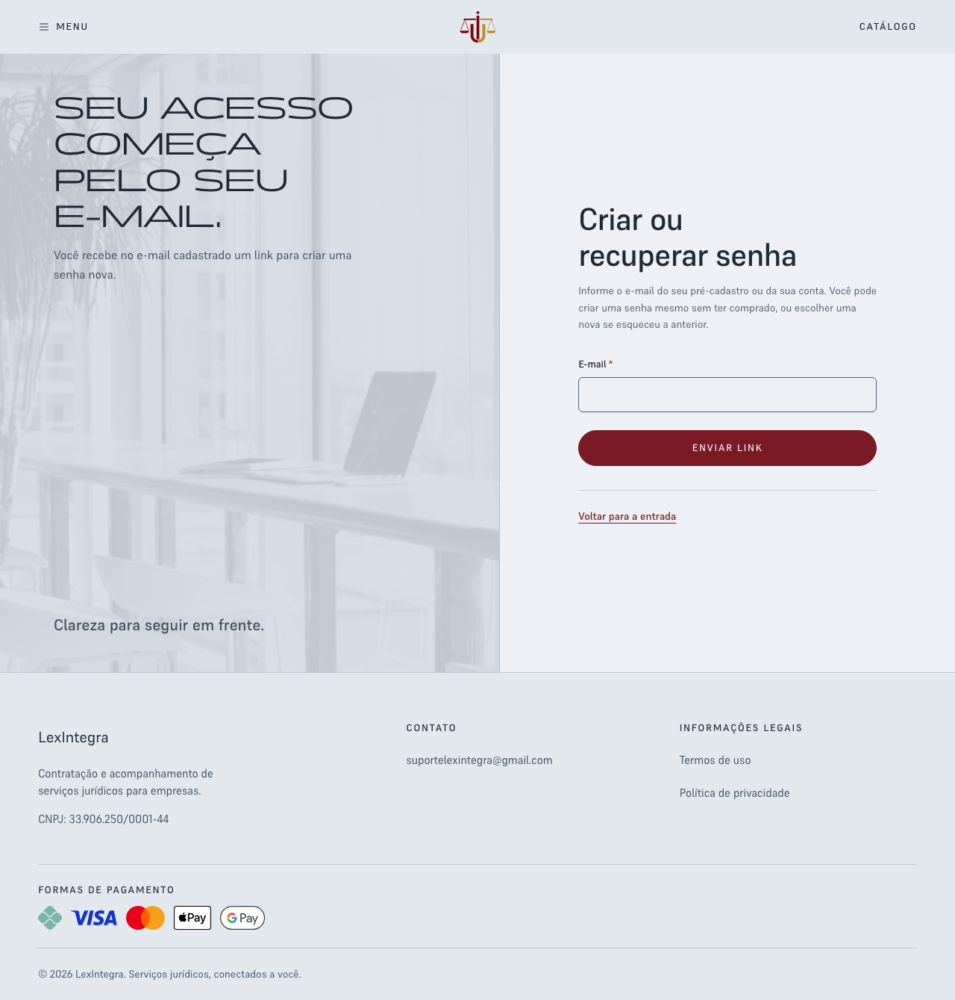

Você também pode pedir a senha antes de comprar, se já fez o cadastro inicial:
o mesmo caminho de recuperação serve.

## 5. A ficha inicial

No primeiro acesso depois da primeira compra, a plataforma pede a **ficha
inicial**: informações da **empresa** (cadastro, operação, faturamento,
passivo trabalhista, autuações e reclamações). Ela é preenchida **uma vez só**,
vale para todos os pedidos e é lida apenas pelo advogado do pedido e pela
administração. Não pede dado pessoal sensível.

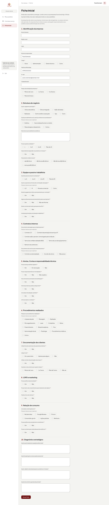

Clique em **Enviar ficha** no fim. Depois disso, a sua área abre normalmente.

## 6. Meus pedidos

Em **Meus pedidos** (`/painel`) cada pedido é um **cartão**, com o preço, a
situação ("Em análise" enquanto não tem advogado, "Em andamento" depois), os
documentos a receber e as reuniões. No topo, um resumo do que está em
andamento, do que espera a sua revisão e do que já foi concluído.

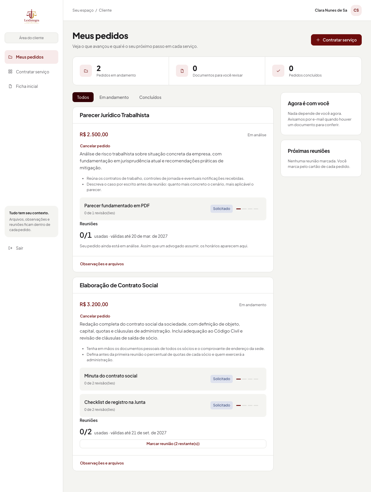

Tudo o que diz respeito a um pedido (reuniões, arquivos, observações,
documentos) fica **dentro do cartão dele**.

## 7. Enviar arquivos e observações

No cartão, clique em **Observações e arquivos**.

- **Nova observação:** escreva e clique em **Enviar observação**. O escritório
  vê e pode responder.
- **Arquivos de apoio:** clique em **Escolher arquivos**, selecione e clique
  em **Anexar ao pedido**. Limites:
  - **JPG ou PDF**;
  - **até 5 MB** cada;
  - **até 3 arquivos** por envio.

  Arquivo de outro tipo, maior que 5 MB ou o quarto arquivo são recusados.
  Todo arquivo passa por verificação de vírus antes de ficar disponível ao
  escritório.

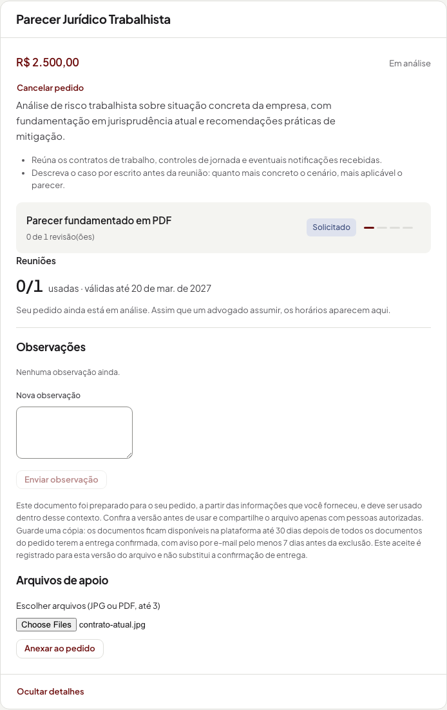

Envie só o necessário para o serviço: documentos podem ter dados de outras
pessoas.

## 8. Reuniões

Cada serviço inclui um número de reuniões, que vale por um prazo contado da
compra (por exemplo, "0/2 usadas · válidas até 21 de set. de 2027"). Só dá
para marcar depois que um advogado assumir o pedido.

### Marcar

1. No cartão, clique em **Marcar reunião**.
2. No calendário, os **dias destacados** têm horário livre. Feriados aparecem
   marcados. Use as setas para mudar de mês.
3. Escolha o dia e o horário e clique em **Confirmar reunião**.

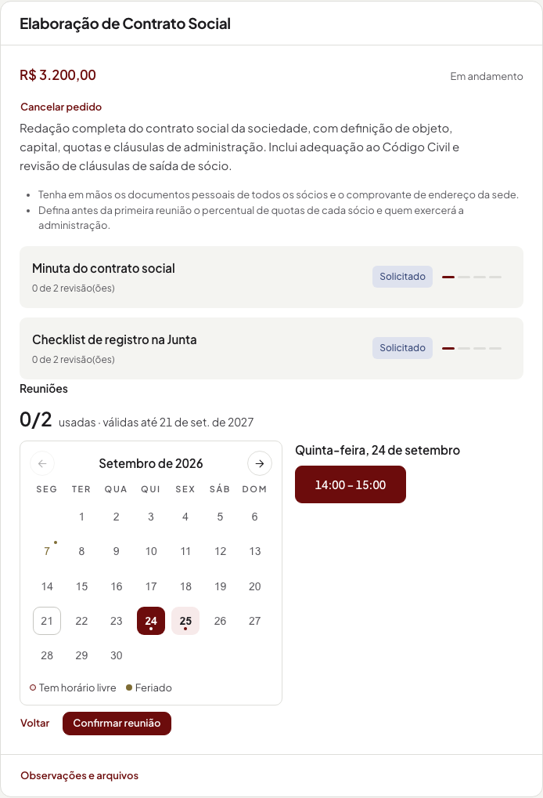

Regras:

- **pelo menos 24 horas de antecedência**;
- respeitando o **intervalo mínimo** entre reuniões do mesmo pedido, quando o
  serviço tiver um;
- dentro do saldo e do prazo de validade do pedido.

Assim que a sala é criada, o cartão mostra **Abrir sala**, e chega um e-mail
com o **convite de calendário** (arquivo `.ics`): abra-o para adicionar a
reunião à sua agenda (Gmail, Outlook ou Apple). Enquanto a sala está sendo
criada, o cartão mostra "Link a caminho…".

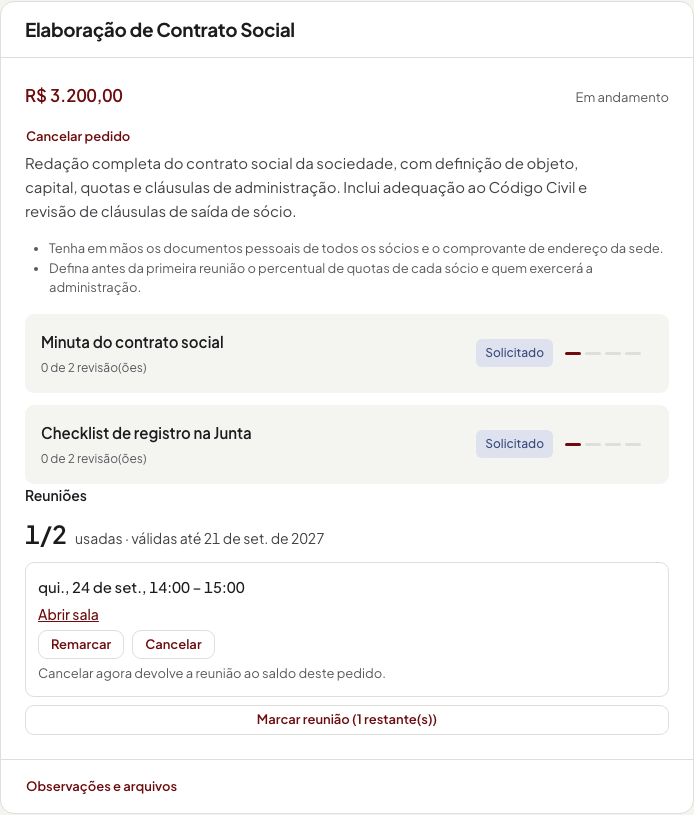

### Entrar na reunião

Na hora marcada, clique em **Abrir sala** (no cartão ou no convite). A reunião
é pelo **Microsoft Teams**, e você entra **como convidado**: abra no navegador,
digite o seu nome e entre. Não precisa de conta da Microsoft nem de instalar
nada. Não há sala de espera, e a reunião não é gravada.

### Remarcar

Clique em **Remarcar**, escolha o novo horário e clique em **Confirmar novo
horário**. A reunião continua a mesma (o saldo não muda), o link continua o
mesmo e chega um convite atualizado. Remarcar também exige **24 horas** de
antecedência.

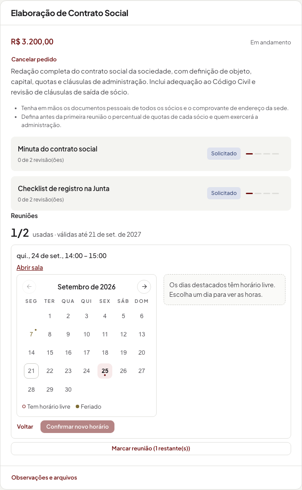

### Cancelar

Clique em **Cancelar**. A tela avisa **antes** se a reunião volta ao saldo:

- com **24 horas ou mais** de antecedência, ela volta ao saldo do pedido;
- com **menos de 24 horas**, o cancelamento é aceito, mas a reunião **não**
  volta ao saldo.

Se o escritório precisar desmarcar uma reunião, a reunião sempre volta ao
saldo, e você recebe um e-mail convidando a marcar outro horário.

## 9. Receber o documento, pedir revisão e confirmar

Quando o advogado envia um documento, ele passa por verificação de segurança
("Arquivo em verificação de segurança") e, em seguida, aparece no cartão:

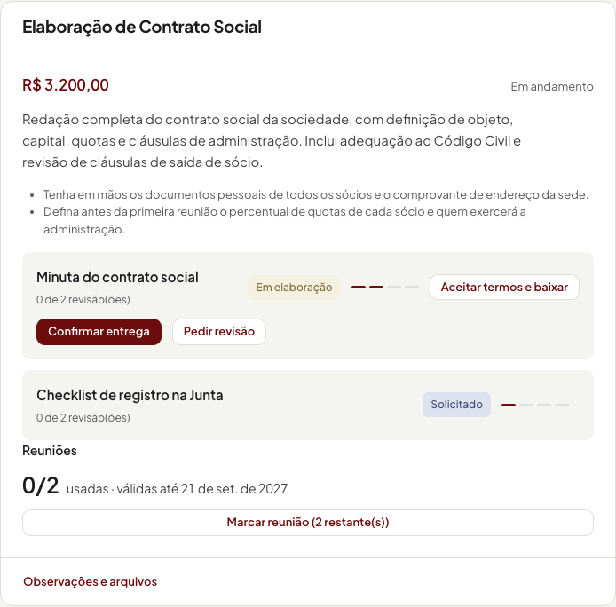

- **Aceitar termos e baixar:** antes do primeiro download de cada versão, você
  aceita o termo de uso do documento. O aceite vale para aquela versão.
- **Pedir revisão:** o documento volta ao advogado. Cada documento tem um
  número de revisões incluídas ("0 de 2 revisão(ões)"); quando acabam, o botão
  some.
- **Confirmar entrega:** encerra aquele documento. É só você quem confirma.

**Guarde uma cópia.** Os documentos e os seus arquivos de apoio ficam
disponíveis até **30 dias depois** de todos os documentos do pedido terem a
entrega confirmada. Você recebe um e-mail pelo menos **7 dias antes** da
exclusão.

## 10. Cancelar o pedido

No cartão, clique em **Cancelar pedido**. O botão só aparece enquanto o
trabalho **não começou**: nenhum documento em elaboração, nenhuma reunião já
realizada e nenhuma contestação aberta. As reuniões futuras do pedido são
desmarcadas.

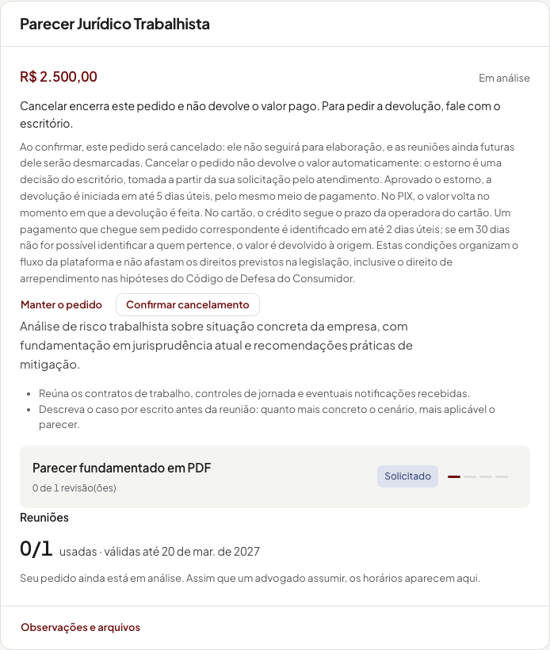

**Cancelar não devolve o valor automaticamente.** Para pedir a devolução,
escreva para `suportelexintegra@gmail.com`. O estorno é decisão do escritório;
aprovado, a devolução começa em até 5 dias úteis, pelo mesmo meio de
pagamento (no PIX, na hora; no cartão, no prazo da operadora). Seus direitos
pelo Código de Defesa do Consumidor estão preservados.

## 11. Seus dados

A política de privacidade está em **https://lexintegra.com.br/privacidade**.
Para pedir uma cópia dos seus dados ou a exclusão deles, escreva para
`suportelexintegra@gmail.com`. O prazo de resposta é de **15 dias corridos**.
